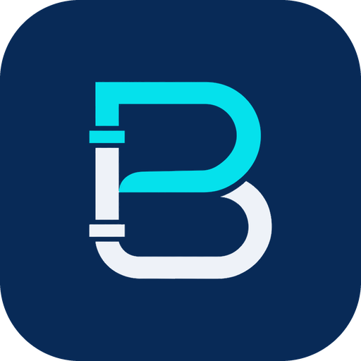

<div align="center">



# Baton

**Speak it. Baton hands it over.**

A shift-handover safety system for process plants. Operators say what they saw; deterministic rules check it against the plant; Gemini agents read, explain and brief; people accept.

**Team ETERNAUTS · Google Cloud AI Builder Cup 2026**

[**Try the app**](https://baton-app-vapgvudrgq-as.a.run.app) · [Control Room dashboard](https://baton-api-545013329202.asia-southeast1.run.app/dashboard) · [Architecture and agents](backend/AGENTS.md)

</div>

---

## Watch the 10-second teaser

[](docs/media/baton-teaser.mp4)

<sub>Silent preview, plays in a loop. The full 10-second video with sound is [docs/media/baton-teaser.mp4](docs/media/baton-teaser.mp4) (GitHub may offer it as a download).</sub>

**Storyboard**

- **Shot 1 (0–2s):** Offshore oil rig technician in an orange coverall, white hard hat and safety glasses on a steel walkway at golden hour, derrick and calm sea behind. They say: *"Minor oil leak near pump station three."*
- **Shot 2 (2–4s):** Chemical plant operator in a flame-resistant suit and face shield beside glowing pipe racks at dusk. They say: *"Pressure reading high on line four."*
- **Shot 3 (4–6s):** Miner with a headlamp and hi-vis vest in a tunnel lit by work lights. They say: *"Loose rock on the east wall."*
- **End card (6–8s):** The screen cuts to a deep navy background. A cyan and white pipe-shaped letter "B" logo assembles itself from flowing pipe lines with a soft glow, then the word "Baton" fades in beside it, followed by the tagline *"Speak it. Baton hands it over."* in clean white sans-serif type. The amber glow of the microphone button fades into a subtle light behind the logo. Smooth, minimal, premium motion graphics.

---

## Try it in one click

| | Link | What you can do |
|---|---|---|
| **Baton app** (website, same code as the Android app) | https://baton-app-vapgvudrgq-as.a.run.app | Type or speak a note, review what the AI read, submit, watch it sync, then run the **Handover** interview with a supervisor read-back |
| **Control Room** (supervisor dashboard) | https://baton-api-545013329202.asia-southeast1.run.app/dashboard | See every sync, the rule conflicts, the architecture live, the agent trace, and ask the logs. Unlock the agent screens with the supervisor key |

A good first run: open the app, tap the keyboard icon, type *"Pump P-201B is isolated and locked out"*, tap **Check what was read**, then **Submit**. The server finds a CRITICAL isolation mismatch (the plant feed says P-201B is still OPEN). Open the **Handover** tab, answer the questions, and read the critical item back as the incoming supervisor. Then open the dashboard and watch the same event, its agent trace and its cited brief.

> The plant feed is **simulated** (`backend/app/plant_data.py`). Rule R4 (an expired permit) is always open in it, so it appears in every brief.

---

## Why Baton

Most process-safety accidents at shift change come from one thing: what the outgoing shift *believes* is not what the plant *is*. A lock-out that was "applied" but is still open. A hot-work permit next to a live gas line.

> **Rules decide, Gemini reads and explains, people accept.**

- **Rules decide.** Safety verdicts come only from deterministic code (`backend/app/rules.py`). A model can add concerns; it can never remove, soften or contradict a rule verdict, and it can never say a conflict is clear while one is open.
- **Gemini reads and explains.** It reads spoken notes in any language, retrieves the relevant procedures, explains each verdict with citations, and writes the incoming-shift brief.
- **People accept.** Acknowledging an alert is a supervisor action and is recorded as *acknowledged*, never *resolved*. A handover cannot be transferred until the incoming supervisor has read every CRITICAL item back in their own words.

## How it works

```
Baton app (Android + web) ──sync──▶ baton-api (Cloud Run)
   speak / type a note                │ 1. rules R1–R4 against the plant feed (deterministic)  ← answers in ~0.3 s
   on-device Gemma (Android)          │ 2. save to Firestore, 3. publish "handover.synced"
   or server model (web)              ▼
                               Pub/Sub ──push (OIDC)──▶ baton-agents (Cloud Run, private)
                                                          ADK pipeline: Intake → SOP + history retrieval (vector search)
                                                          → RulesGate → SafetyCrossCheck → Briefing → Distill
                                                          (guardrails check every model output)
Control Room dashboard ◀── stream: events, conflicts, briefs, agent traces
Ask the logs · Handover interview · Device alerts
```

| Cloud Run service | What it is |
|---|---|
| `baton-app` | The Baton website (Flutter web build behind nginx) |
| `baton-api` | API (sync, ask, extract, interview, transcription) and the Control Room dashboard |
| `baton-agents` | Private worker that runs the multi-agent pipeline from Pub/Sub |

Deeper detail (agents, tools, guardrails, data model, evaluation): [backend/AGENTS.md](backend/AGENTS.md).

## What's in it

| Capability | How |
|---|---|
| **Voice and typed notes** | On-device Gemma 4 (Android) or the server's Gemini Flash-Lite (web, or phones without the model); cloud transcription (Gemini or Chirp 3) with translation that keeps asset tags intact |
| **Review before submit** | The worker sees what the AI read (asset, state) and can correct it; the corrected facts are what is saved |
| **Deterministic safety rules** | R1 isolation mismatch, R2 simultaneous operations, R3 interlock bypass, R4 expired permit |
| **Multi-agent pipeline** | Google ADK: SOP and history retrievers, rules gate, safety cross-check, briefing agent, all with stage time budgets and deterministic fallbacks |
| **Vector knowledge store** | Firestore vector search (768-d, cosine) over SOPs, bulletins and earlier handovers |
| **Guardrails** | Verdict lock, no false all-clear, citations must exist, advisory items capped at WARNING; all logged in the trace |
| **Interview handover** | One question per distinct open conflict, a cited brief, a supervisor read-back for every CRITICAL item, a gated transfer |
| **Ask (query mode)** | A worker with a doubt, or working under a permit, asks the plant's documents a question by voice or text. Matching documents appear in about 0.8 s, then a cited answer with ordered steps and stop-work cautions in about 3 to 4 s. Pick a permit and the answer is about that job; an expired permit is a red stop notice. Open safety conflicts always sit beside the answer, and tapping a source opens the exact wording |
| **Ask the logs** (supervisor) | The deeper multi-step agent behind the Control Room: questions answered only from retrieved evidence, in the question's language (English, Tamil, Malay verified) |
| **Control Room** | Overview, living architecture, telemetry, audit trail, agent trace, debug console |
| **Idempotent sync** | The same capsules always map to the same handover, so a retry never creates a second event or agent run |
| **Two-key security** | The supervisor key is for dashboard actions; a separate demo key ships inside the public app and opens the app endpoints only |

### Measured on the live service

| Measure | Result |
|---|---|
| Retrieval: expected source in top 6 | 12 / 12 |
| Answer cites an expected source | 12 / 12 |
| Rule verdicts preserved in briefs | 3 / 3 |
| Off-topic questions declined cleanly | 2 / 2 |
| Ask latency | median 6.4 s, p90 11.5 s |
| Pipeline latency | median 11.9 s (single runs) |
| Load: 20 syncs in a minute | 20 / 20 succeeded, 0 duplicates, 0 lost |
| Query mode (live documents) | documents in about 0.8 s, cited answer in about 3.7 s |
| Tests | 190 backend, 23 app |

## How Baton compares

We surveyed digital shift logbooks, permit-to-work suites, industrial AI copilots, voice-first logs and the accident literature. The established products record and route information well and the new copilots answer questions well; in the material we reviewed, none combines rule-based checking of the outgoing shift's claims against the plant, a recorded supervisor read-back before transfer, and permit-aware document answers with the open conflicts always on screen. Baton's unique selling points, the comparison table and the limits of this survey are in [docs/LITERATURE_SURVEY.md](docs/LITERATURE_SURVEY.md).

## Repository layout

```
backend/        FastAPI service, ADK agents, rules, knowledge store, tests, eval, deploy scripts
  app/            main.py (API), rules.py, agents/ (pipeline, ask, guardrails), knowledge/, pipeline/, static/dashboard.html
  scripts/        deploy.sh (canary | promote | agents), setup_web.sh, setup_pubsub.sh, ingest_sops.py, seed_handovers.py
aegis_flow/     The Flutter app: one codebase for Android and the web
  lib/            core/ (AI, platform, config), data/, features/ (report, feed, handover), ui/
  web_hosting/    Dockerfile + nginx config for the website service
  scripts/        deploy_web.sh
sandglass/      Separate document-grounded answer service for constrained links
docs/            LITERATURE_SURVEY.md, media/ (teaser video and poster)
```

## Run it locally

**Backend**
```bash
cd backend
python -m venv .venv && source .venv/bin/activate
pip install -r requirements-dev.txt
cp .env.example .env            # then fill in your project and models
uvicorn app.main:app --reload --port 8080
pytest -q                       # 190 tests, no network
```

**App** (Flutter)
```bash
cd aegis_flow
flutter pub get
flutter test --dart-define=AEGIS_API_KEY=test
flutter run --dart-define=AEGIS_API_KEY=<demo key>                                   # Android
flutter run -d chrome --dart-define=AEGIS_API_KEY=<demo key> --dart-define=BACKEND_URL=<api url>   # web
```

## Deploy

```bash
backend/scripts/setup_web.sh           # once: creates the demo key for the public app
backend/scripts/deploy.sh canary       # API: new revision at 0% traffic
backend/scripts/deploy.sh promote      # send traffic to it
backend/scripts/deploy.sh agents       # the Pub/Sub worker, from the same image
aegis_flow/scripts/deploy_web.sh       # the website, built from the same code as the Android app
```

Android and the website build from the same `aegis_flow` code, so a change to the app reaches both.

## Security notes

- `AEGIS_API_KEY` (supervisor) and `AEGIS_DEMO_KEY` (public app) live in Secret Manager. Never build a public website or APK with the supervisor key.
- Audio, full transcripts and keys are never logged; logs carry ids, counts, latencies and status codes.
- The public app can call model-backed endpoints through the demo key. Rate limiting is on, and a budget alert on the project is recommended for the judging period.

## Known limitations

- The plant feed is simulated, not live telemetry, and the dashboard says so. Rule R3 does not fire on it, and R4 is always open.
- Open conflicts are unit-wide, not per asset.
- Model latency has an occasional tail; stage time budgets turn it into a deterministic fallback, never a missing verdict.
- The Android app uses the on-device model only when it is installed (a large download); otherwise it uses the server model.

Full list: [backend/AGENTS.md, section 9](backend/AGENTS.md).

## Other services in this repo

**Sandglass** (`sandglass/`) is a separate Cloud Run service: the on-device Gemma model sends short questions over a constrained link, and Sandglass searches the document corpus (rule-based expansion, BM25 and Vertex AI embeddings), has Gemini answer with verified citations, and returns a compact answer with a calibrated confidence. See [sandglass/README.md](sandglass/README.md).

---

<div align="center"><sub>Built by Team ETERNAUTS for the Google Cloud AI Builder Cup 2026.</sub></div>
